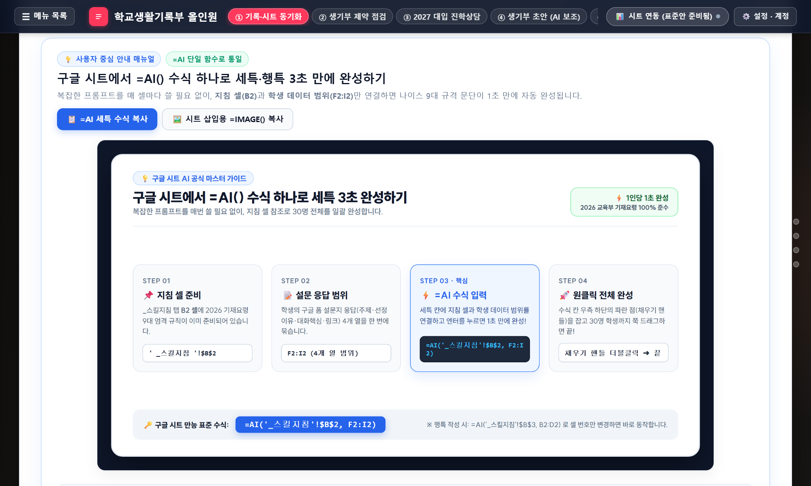
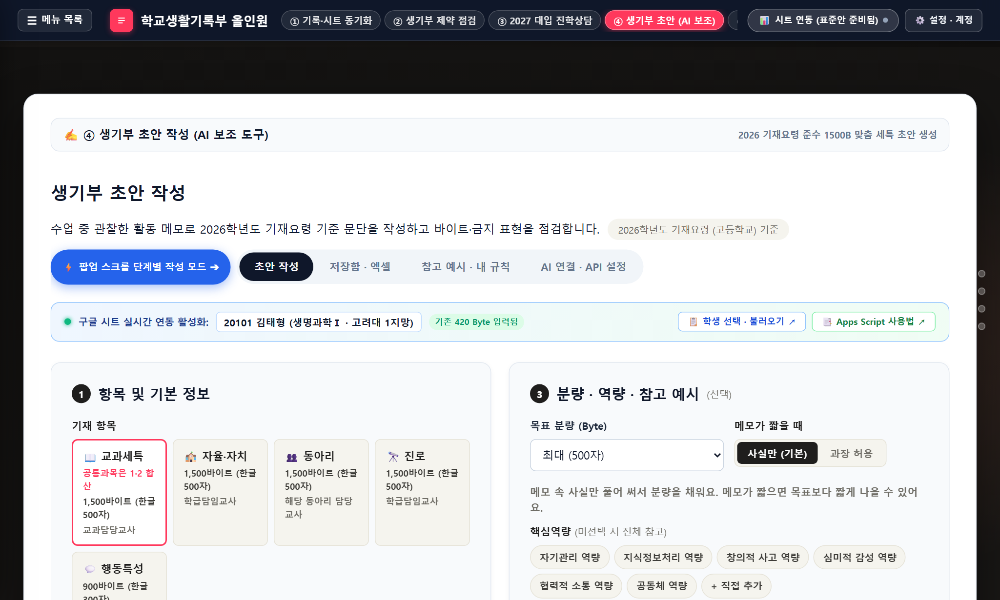
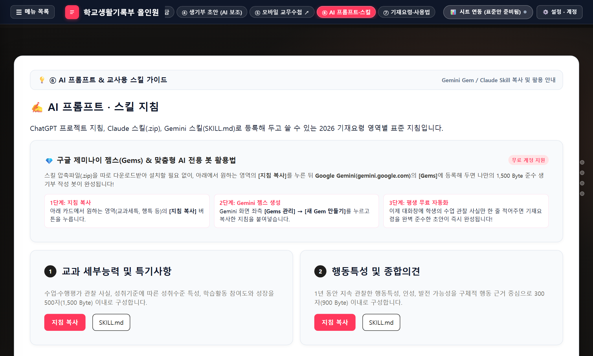
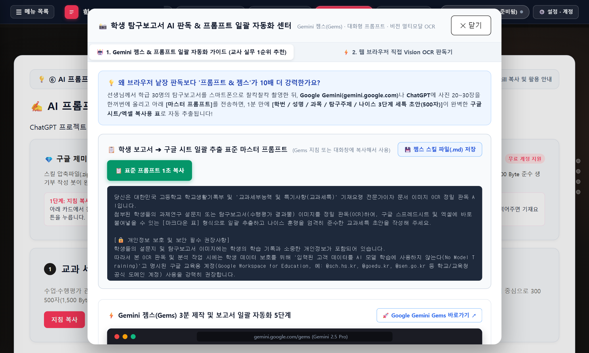
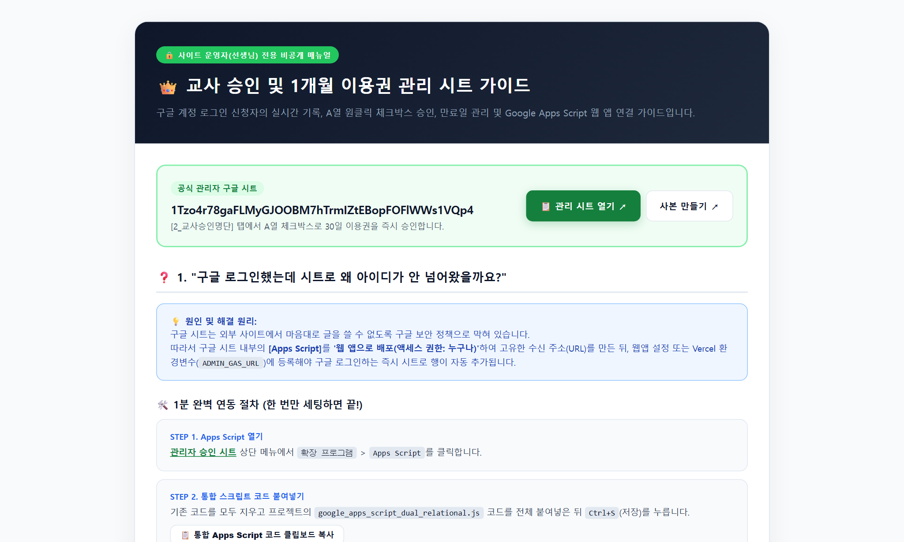

# [교사용 운영 매뉴얼] 학교생활기록부 및 대입진학상담 올인원 시스템

- 시스템 명칭: 2026-2027 학교생활기록부 및 대입진학상담 올인원 시스템
- 적용 대상: 고등학교 1·2·3학년 교과담당 교사 및 학급담임 교사 (2028 개편 5등급제 호환)
- 웹앱 접속 주소: https://neis-help-one.vercel.app/
- 슬라이드 매뉴얼: https://neis-help-one.vercel.app/slides
- 관리자 승인 매뉴얼: https://neis-help-one.vercel.app/admin
- 모바일 교무수첩: https://t-ong.vercel.app/

---

## 목차
1. [화면 01] 종합 대시보드 및 시스템 메인 관제 허브
2. [화면 02] 관계형 구글 시트 사본 생성 및 셀 입력 색상 규칙
3. [화면 03] AI 세특 초안 생성 워크벤치 및 =AI() 수식 실행
4. [화면 04] 영역별 AI 프롬프트 및 스킬 지침 6대 영역
5. [화면 05] 학생 보고서·설문지 OCR 이미지 판독기 및 교육용 계정 보안
6. [화면 06] 교육부 나이스 4대 기재요령 제약 실시간 사전 점검기
7. [화면 07] 2027 대입 진학상담 및 2028 개편 5등급제 대학 탐색
8. [화면 08] 모바일 교무수첩(t-ong) 실시간 현장 기록 및 클라우드 동기화
9. [화면 09] 교사 이용 승인 및 관리자 시트 운영 체계
10. [가이드] 교과교사 시작 4단계 핵심 체크리스트 및 최초 1회 권한 승인
11. [안내] 자주 묻는 질문(FAQ) 및 시스템 오류 대처 요령

---

## 1. [화면 01] 종합 대시보드 및 시스템 메인 관제 허브

본 화면은 학번(5자리 ID)을 기준으로 관계형 시트의 8개 탭 진행 현황과 항목별 결손(미작성) 상태를 한눈에 파악하는 총괄 관제 허브입니다.


### [1. 화면 구성 요소]
1. **상단 네비게이션 탭**: [관계형시트], [점검기], [2027대입], [초안생성], [교무수첩], [AI프롬프트], [설명서]로 원클릭 전환할 수 있는 고정 바.
2. **핵심 지표 통계 카드**: 등록 학생 수, 명렬표 완성률, 세특 완료율, 대입 상담 미실시 현황을 4개 카드로 자동 계산하여 출력.
3. **학생별 종합 점검표 테이블**: 학번, 성명, 희망진로 및 각 영역별 상태 배지([완비], [보완 필요], [미작성]) 표시.

### [2. 교사 조작 절차]
1. 웹앱 접속 후 첫 화면의 **[학생별 점검표]**를 확인합니다.
2. 상태가 [미작성] 또는 [보완 필요]로 표시된 학생 행의 우측 **[바로가기]** 버튼을 클릭합니다.
3. 해당 학생의 세특 초안 생성 화면이나 상담 화면으로 즉시 이동하여 결손 데이터를 입력합니다.

### [3. 핵심 유의사항]
- 학번(ID) 하나로 전교생 명렬이 모든 탭에 자동 상속되므로 중복 입력이나 번호 불일치 오류가 발생하지 않습니다.

---

## 2. [화면 02] 관계형 구글 시트 사본 생성 및 셀 입력 색상 규칙

선생님의 개인 구글 드라이브로 독립적인 시트를 복사하고, 교사가 직접 입력할 영역과 자동 계산 영역을 시각적으로 명확히 구분합니다.



### [1. 화면 구성 요소]
1. **카드 1 (학급담임용 시트)**: 0_시트안내, 1_종합대시보드, 2_학생명렬표, 3_창체_행특, 4_대입상담, 5_상담기록, 6_교과세특_연동 탭 구성.
2. **카드 2 (교과담임용 시트)**: 0_시트안내, 1_종합대시보드, 2_수강생명렬표, 3_수업관찰_기록, 4_AI세특_작성, 5_담임시트_내보내기, _스킬지침 탭 구성.
3. **색상 구분 안내 배너**: 흰색(#FFFFFF) 셀만 직접 입력하고 유색 셀은 수정하지 않도록 시각적 기준 제시.

### [2. 교사 조작 절차]
1. 교과담당 교사는 카드 2의 초록색 버튼 **[교과담임용 시트 사본 만들기]**를 클릭합니다.
2. 브라우저 새 창에서 구글 드라이브의 **[사본 만들기]** 버튼을 승인합니다.
3. 내 드라이브에 복사된 시트를 열고, 오직 **순백색(#FFFFFF) 셀**에만 학생 데이터와 관찰 기록을 입력합니다.

### [3. 색상별 데이터 입력 표준]
- **순백색 (#FFFFFF) 셀 [직접 입력]**: 학번, 성명, 관찰 메모, 설문 응답(F~I열) 등 교사가 직접 기록하는 칸입니다.
- **연회색 (#F8FAFC) 및 연하늘색 (#EFF6FF) 셀 [수식/자동 계산]**: =AI(), =NEIS_BYTES(), VLOOKUP 등 자동 연동 공식이 들어있으므로 내용을 지우거나 임의 수정하지 마십시오.

---

## 3. [화면 03] AI 세특 초안 생성 워크벤치 및 =AI() 수식 실행

복잡한 프롬프트를 매번 복사할 필요 없이, 프롬프트는 지침 셀에 두고 본문에서는 수식 한 줄로 세특 초안을 일괄 작성합니다.



### [1. 표준 권장 함수 공식]
```excel
=AI('_스킬지침'!$B$2, F2:I2)
```
- **'_스킬지침'!$B$2 (첫 번째 인수)**: 고교 교사 역할, 팩트 기반, 주어 생략, 개조식 종결 등 기재요령 9대 규칙 프롬프트가 저장된 셀.
- **F2:I2 (두 번째 인수)**: 학생이 제출한 주제(F), 선정이유(G), AI 대화핵심(H), 참고링크(I) 4개 열 데이터 범위.

### [2. 교사 조작 절차]
1. 시트의 `4_AI세특_작성` 탭 F~I열에 학생 구글 폼 설문 응답을 붙여넣습니다.
2. 첫 번째 학생 행인 **E2 셀**에 `=AI('_스킬지침'!$B$2, F2:I2)`를 입력하고 Enter를 누릅니다.
3. 생성된 초안을 확인한 후, E2 셀 우측 하단의 작은 점(**채우기 핸들**)을 마우스로 **더블클릭**합니다.
4. 30명 전교생 행으로 수식이 자동 복사되어 전원 세특 초안이 완성됩니다.

### [3. 단일 관찰 메모 셀 참조 공식]
```excel
=AI('_스킬지침'!$B$2, D2)
```
- 수업 중 교사가 D2 셀에 작성한 1줄 관찰 메모만을 참조하여 1,500 Byte 3단 논법 초안을 즉시 생성할 수 있습니다.

---

## 4. [화면 04] 영역별 AI 프롬프트 및 스킬 지침 6대 영역

생기부 5대 핵심 영역과 새롭게 신설된 6번째 학생 보고서 OCR 판독 전용 카드를 체계적으로 제공합니다.



### [1. 화면 구성 요소]
- **1번 카드**: 교과세부능력 및 특기사항 (1,500 Byte 이내, 수업 활동 및 성취도 중심)
- **2번 카드**: 행동특성 및 종합의견 (1,500 Byte 이내, 인성 및 잠재력 관찰 중심)
- **3번 카드**: 자율활동 (1,500 Byte 이내, 학급 자치 및 학교 행사 주도성)
- **4번 카드**: 동아리활동 (1,500 Byte 이내, 전공 적합성 및 탐구 역량)
- **5번 카드**: 진로활동 (2,100 Byte / 700자 이내, 진로 탐색 및 상담 결과)
- **6번 카드 (초록색 테두리)**: 학생 보고서·설문지 OCR 판독 (교육용 계정 권장 배지 부착)

### [2. 교사 조작 절차]
1. 상단 탭에서 **[AI 프롬프트·스킬]** 버튼을 클릭합니다.
2. 필요한 영역 카드의 **[지침 복사]** 버튼을 클릭하여 클립보드에 복사합니다.
3. 구글 시트의 `_스킬지침` 탭 해당 셀에 붙여넣어 과목 특성에 맞게 수정합니다.
4. 오프라인 파일이 필요한 경우 **[SKILL.md]** 버튼을 눌러 마크다운 파일로 저장합니다.

---

## 5. [화면 05] 학생 보고서·설문지 OCR 이미지 판독기 및 교육용 계정 보안

종이로 제출된 학생들의 탐구보고서나 설문지 사진을 일괄 업로드하여 구글 시트 복사용 마크다운 표로 자동 변환합니다.



### [1. 학생 데이터 보호 필수 보안 권장]
> **[중요] 구글 교육용 계정(Google Workspace for Education) 사용 필수 권장**  
> 학생들의 설문지 및 탐구보고서 사진에는 학생 성명, 학번, 관심 분야 및 학습 기록 등 민감한 개인정보가 담겨 있습니다.  
> 따라서 본 OCR 판독 작업 시에는 학생 데이터 보호를 위해 **'입력된 고객 데이터를 AI 모델 학습에 절대 사용하지 않는다(No Model Training)'**고 교육청 및 구글 간 계약에 명시된 **구글 교육용 계정(@sch.hs.kr, @goedu.kr, @sen.go.kr 등 학교/교육청 공식 도메인 계정)** 사용을 강력히 권장합니다.

### [2. OCR 판독 3대 원칙 및 세특 작성 9대 규칙]
1. **손글씨·비문 자동 교정**: 학생의 연필 필기, 흘림체, 오탈자를 문맥에 맞추어 올바른 학술 어휘로 복원.
2. **수식·기호 원형 보존**: 수학 수식, 과학 기호, 영문 학술용어를 디지털 텍스트로 무왜곡 변환.
3. **4대 핵심 항목 정밀 분별**: [선정 주제], [동기], [AI 대화핵심], [참고링크] 분별 추출.
4. **시작 문구 고정**: "과제연구 시 '[주제]'를 주제로 선택하였으며 AI를 활용해 학술자료를 조사하고 분석함."
5. **9대 작성 규칙**: 팩트 기반, 주어 생략, 작은따옴표 감싸기, 내면 감정 표현 금지, 현재/완료시제, 100~250자 준수.

### [3. 교사 조작 절차 (Gemini Gems 활용)]
1. 6번 카드에서 **[판독기 열기]**를 클릭한 후 **[표준 프롬프트 복사]** 버튼을 누릅니다.
2. Google Gemini(gemini.google.com)에 구글 교육용 계정으로 로그인합니다.
3. 좌측 [Gems 매니저] > [+ 새 Gem]을 누르고, 지침란에 복사한 프롬프트를 붙여넣고 저장합니다.
4. 학생 보고서 사진 10~30장을 한 번에 업로드하면 아래 형식의 마크다운 표가 자동 출력됩니다:
```markdown
| 학번 | 성명 | 과목명 | 탐구주제 | 선정이유 | AI 대화핵심 | 참고링크 | 1,500B 교과세특 초안 |
```
5. 출력된 표 전체를 복사하여 구글 시트 `4_AI세특_작성` 탭에 붙여넣습니다.

---

## 6. [화면 06] 교육부 나이스 4대 기재요령 제약 실시간 사전 점검기

나이스 전송 전 감사 지적이나 기재 오류를 사전에 100% 차단하는 실시간 검증기입니다.


### [1. 4대 사전 점검 항목]
1. **나이스 전산 바이트(1,500 Byte) 계산**: 한글 1자=3B, 영문/숫자/공백=1B, 줄바꿈(엔터)=2B 공식 반영.
2. **금지어 100% 실시간 적발**: 공인어학시험, 교외경시대회, 사교육 기관명, 부모 직업 하이라이트 표시.
3. **불필요한 주어 생략 검증**: '이 학생은', '본인은' 등 바이트를 낭비하는 주어 적발.
4. **개조식 종결어미 검증**: 문장 끝이 '-함', '-임', '-음' 명사형 동사로 끝나는지 확인.

### [2. 교사 조작 절차]
1. 상단 메뉴에서 **[점검기]** 탭을 클릭합니다.
2. 검증할 문구를 입력창에 붙여넣습니다.
3. 우측에 즉시 표시되는 바이트 수와 위반 항목을 확인한 후 **[원클릭 자동 교정]**을 누릅니다.
4. 교정 완료된 최종 문구를 복사하여 나이스에 입력합니다.

---

## 7. [화면 07] 2027 대입 진학상담 및 2028 개편 5등급제 대학 탐색

고1·고2 학생들의 대입 상담을 위한 133개 전국 주요 대학 전형 DB 및 5등급제 환산 엔진입니다.


### [1. 화면 구성 요소]
- **5등급제 내신 환산기**: 고1 5등급제 성적(1.00~5.00) 입력 시 9등급제 환산 및 오차 범위(+-0.30) 자동 계산.
- **전형별 필터**: 계열(인문/자연/의약학), 전형(교과/종합/논술), 지역(수도권/비수도권) 원클릭 필터.
- **대학 전형 카드**: 대학명, 전형명, 전년도 70% Cut, 지원 성향 판정([안정], [적정], [소신]) 표시.

### [2. 교사 조작 절차]
1. 상단에서 **[2027 대입 진학상담]** 탭을 클릭합니다.
2. 학생의 내신 등급과 지망 계열을 선택하여 지원 가능 대학 리스트를 조회합니다.
3. 적합한 대학 카드의 **[수시 6장 담기]**를 클릭하여 포트폴리오를 구성합니다.
4. **[Google Docs 상담일지 생성]**을 클릭하여 학부모 상담용 리포트를 출력합니다.

---

## 8. [화면 08] 모바일 교무수첩(t-ong) 실시간 현장 기록 및 클라우드 동기화

수업 중 스마트폰이나 태블릿으로 학생 관찰 메모를 남기면 구글 시트로 실시간 동기화되는 모바일 솔루션입니다.


### [1. 교사 조작 절차]
1. 교실 입실 전 스마트폰으로 `https://t-ong.vercel.app/`에 접속합니다.
2. 수업 중 학생 좌석이나 이름을 탭하고 음성 또는 키보드로 관찰 메모를 남깁니다.
3. 저장된 메모는 교무실 PC 구글 시트 `3_수업관찰_기록` 탭으로 1초 만에 클라우드 자동 동기화됩니다.
4. 학기말에 `=AI()` 함수가 누적된 관찰 메모를 읽어내어 개별 맞춤 세특을 생성합니다.

---

## 9. [화면 09] 교사 이용 승인 및 관리자 시트 운영 체계

체크박스 원클릭으로 교사 계정에 정식 이용권을 부여하는 관리자 전용 운영 체계입니다.



### [1. 3단계 승인 파이프라인]
1. **1단계 교사 신청**: 교사가 사이트에서 Google 로그인을 완료하면 관리자 시트 `2_교사승인명단` 탭에 접속 정보가 1행 자동 생성됩니다.
2. **2단계 체크박스 승인**: 관리자 교사는 A열 체크박스([V])를 클릭하기만 하면 즉시 1개월 정식 이용권이 부여됩니다.
3. **3단계 만료일 자동 계산**: 승인일 기준 만료일이 자동 표기되며, 관리자 대시보드에 활성 교사 수가 자동 집계됩니다.

---

## 10. [가이드] 교과교사 시작 4단계 핵심 체크리스트 및 최초 1회 권한 승인

| 단계 | 수행 항목 | 소요 시간 | 작업 위치 및 방법 |
|:---:|:---|:---:|:---|
| **STEP 01** | **교과담임용 시트 사본 만들기** | 10초 | 웹앱 [관계형 시트] 패널에서 초록색 버튼 클릭 -> 내 드라이브에 복사 |
| **STEP 02** | **무료 Gemini API 키 등록** | 1분 | Google AI Studio(aistudio.google.com)에서 발급 -> 시트 메뉴 [생기부 올인원] > [Gemini API 키 설정] |
| **STEP 03** | **'_스킬지침' 탭 확인** | 1분 | `_스킬지침` B2 셀 문구를 확인하고 담당 교과목에 맞게 수정 |
| **STEP 04** | **설문 입력 & =AI() 실행** | 1분 | 순백색 셀(F~I열)에 설문 결과 붙여넣고 E2 셀에 `=AI('_스킬지침'!$B$2, F2:I2)` 입력 후 채우기 핸들 더블클릭 |

### [최초 1회 Apps Script 보안 권한 승인 안내]
시트 메뉴에서 API 키를 등록하거나 커스텀 함수를 처음 실행할 때 구글의 보안 확인 창이 나타납니다:
1. [권한 검토] 클릭
2. 본인 구글 계정 선택
3. 좌측 하단 [고급] 클릭
4. [안전하지 않은 페이지로 이동] 클릭
5. [허용] 클릭  
※ 최초 1회만 클릭하면 이후 영구적으로 자유롭게 동작합니다.

---

## 11. [안내] 자주 묻는 질문(FAQ) 및 시스템 오류 대처 요령

- **Q1. 학생 개인정보가 구글 서버로 유출되지 않나요?**  
  답변: 본 시트는 교사의 개인 구글 드라이브 안에서만 구동되며, =AI() 함수 호출 시에도 학생 성명이나 인적사항은 제외하고 순수 학술 활동 내용(F2:I2)만 전송하므로 개인정보 보호 법령을 준수합니다.
- **Q2. Gemini API 키는 무료인가요?**  
  답변: 분당 15회 호출까지 완전 무료(Free Tier)로 제공되며, 고교 1개 학급 30명 세특 작성에 충분한 용량입니다.
- **Q3. 다른 과목으로 프롬프트를 변경하려면?**  
  답변: `_스킬지침` 탭 B2 셀을 B3, B4 등에 복사하여 과목별 지침을 적어두고, `=AI('_스킬지침'!$B$3, F2:I2)`처럼 셀 주소만 변경하시면 됩니다.
- **Q4. 수식을 실수로 지웠을 때는?**  
  답변: 즉시 Ctrl + Z(실행 취소)를 누르거나, 윗 행의 E열 수식 셀을 아래로 끌어내려 복사하시면 복구됩니다.
- **Q5. 생성된 세특을 나이스에 바로 등록해도 되나요?**  
  답변: 생기부는 교사의 직접 관찰 기록이 법적 근거입니다. AI가 작성한 초안을 선생님께서 반드시 최종 검토하신 후 나이스에 등록하시기 바랍니다.
