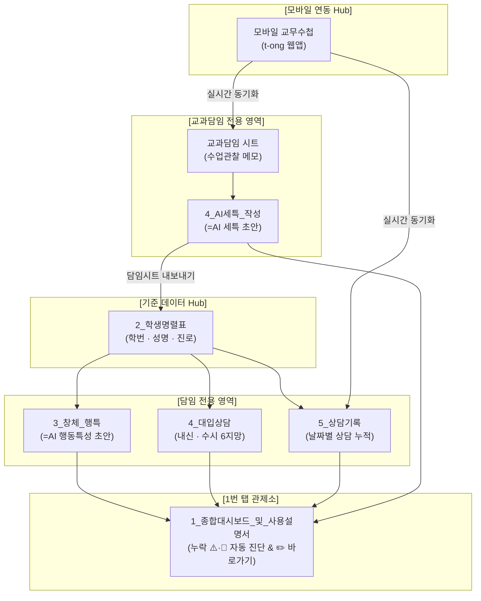

# 🏫 2026-2027 학교생활기록부 & 대입진학상담 올인원 시스템 교사용 운영 매뉴얼

> **개발 및 저작권:** math-tong  
> **적용 학년도:** 2026-2027 학년도 고등학교 1·2학년 (2028 개편 대입 5등급제 완벽 호환)  
> **시스템 접속 주소:** [https://neis-help-one.vercel.app/](https://neis-help-one.vercel.app/)  
> **모바일 교무수첩:** [https://t-ong.vercel.app/](https://t-ong.vercel.app/)  
> **인터랙티브 슬라이드:** `교사용_올인원_프로그램_운영_슬라이드.html`

---

## 📌 목차
1. [전체 시스템 개요 및 관계형 데이터 연결 구조](#1-전체-시스템-개요-및-관계형-데이터-연결-구조)
2. [교과교사가 가장 먼저 해야 할 일과 수정할 일 (시작 Checklist)](#2-교과교사가-가장-먼저-해야-할-일과-수정할-일-시작-checklist)
3. [구글 시트 입력 항목 및 시각적 색상 구분 규칙 (순백색 vs 유색)](#3-구글-시트-입력-항목-및-시각적-색상-구분-규칙-순백색-vs-유색)
4. [교과세특 =AI() 단일 함수 작성법 및 지침 셀 참조 공식](#4-교과세특-ai-단일-함수-작성법-및-지침-셀-참조-공식)
5. [나이스 4대 기재요령 제약 점검 및 1,500 Byte 관리](#5-나이스-4대-기재요령-제약-점검-및-1500-byte-관리)
6. [2027 대입 진학상담 및 2028 개편 5등급제 대학 탐색](#6-2027-대입-진학상담-및-2028-개편-5등급제-대학-탐색)
7. [모바일 교무수첩(t-ong) 실시간 연동 및 현장 기록](#7-모바일-교무수첩t-ong-실시간-연동-및-현장-기록)
8. [단계별 실제 시뮬레이션 작동 화면 갤러리](#8-단계별-실제-시뮬레이션-작동-화면-갤러리)
9. [선생님 필수 FAQ 및 운영 꿀팁](#9-선생님-필수-faq-및-운영-꿀팁)

---

## 1. 전체 시스템 개요 및 관계형 데이터 연결 구조

본 올인원 시스템은 **"학번 하나로 모든 기록이 연결되는 관계형 데이터 솔루션"**입니다. 선생님이 명렬표(학번·성명)를 한 번만 등록해 두면, 행동특성·교과세특·대입상담·상담기록·모바일교무수첩이 유기적으로 연결되어 데이터의 중복 입력을 완전히 제거합니다.



### 🔗 핵심 데이터 흐름 요약
1. **학번(ID) 자동 상속**: `2_학생명렬표`에 입력된 학번과 성명이 모든 하위 탭의 기준 행으로 실시간 자동 참조됩니다.
2. **다교과 취합**: 교과교사가 작성한 세특 초안은 `5_담임시트_내보내기`를 통해 학급담임 시트 `6_교과세특_연동` 탭으로 1초 만에 모아집니다.
3. **대시보드 자동 진단**: 첫 번째 탭인 `1_종합대시보드_및_사용설명서`에서 어떤 학생의 어떤 항목(창체, 행특, 세특, 상담기록, 수시6지망)이 누락(⚠️·🚨)되었는지 실시간으로 집계하며, 옆에 있는 **✏️ 입력 바로가기**를 누르면 해당 칸으로 즉시 이동합니다.

---

## 2. 교과교사가 가장 먼저 해야 할 일과 수정할 일 (시작 Checklist)

교과교사 선생님께서 시트를 복사한 직후 진행해야 할 **초기 설정 4단계 체크리스트**입니다:

| 단계 | 수행 항목 | 소요 시간 | 상세 설명 및 작업 위치 |
|:---:|:---|:---:|:---|
| **1단계** | **교과담임용 시트 사본 만들기** | 10초 | 웹앱 [관계형 시트] 패널에서 **📗 [교과담임용 시트 사본 만들기]** 클릭 ➔ 내 구글 드라이브에 저장. |
| **2단계** | **무료 Gemini API 키 등록** | 1분 | [Google AI Studio](https://aistudio.google.com/)에서 무료 키 발급 ➔ 시트 상단 메뉴 `🏆 생기부 올인원` > `🔑 Gemini API 키 설정` 클릭 후 붙여넣기. |
| **3단계** | **'_스킬지침' 탭 프롬프트 확인 및 수정** | 1분 | `_스킬지침` 탭의 **B2 셀**에 보관된 세특 작성 지침(문장 형식, 팩트 기반, 종결어미 등)을 우리 과목(수학, 영어, 국어, 과학 등) 특성에 맞게 다듬기. |
| **4단계** | **학생 관찰데이터 입력 & =AI() 실행** | 1분 | **순백색(#FFFFFF) 셀**에 학생 명렬 및 구글 폼 설문 응답(F2:I2)을 붙여넣고 `=AI('_스킬지침'!$B$2, F2:I2)` 입력 후 채우기 핸들 더블클릭! |

> [!TIP]
> **최초 1회 Apps Script 권한 승인 창 안내:**  
> 시트 메뉴에서 API 키를 등록하거나 커스텀 함수를 처음 실행할 때 구글의 보안 확인 창이 나타납니다. **[권한 검토] ➔ [내 구글 계정 선택] ➔ [고급] ➔ [이동(안전하지 않음)] ➔ [허용]**을 1회만 클릭하시면 이후 영구적으로 자유롭게 동작합니다.

---

## 3. 구글 시트 입력 항목 및 시각적 색상 구분 규칙 (순백색 vs 유색)

선생님들께서 대규모 시트를 다룰 때 "어느 칸을 건드려야 하고, 어느 칸을 건드리면 안 되는지" 혼란을 겪지 않도록 **국제 표준 시각화 규칙**을 엄격히 적용했습니다:

### 🎨 시각적 색상 구분 원칙
- ✏️ **순백색 (`#FFFFFF`) 배경 + 선명한 테두리**: **선생님 직접 입력 영역** (안심하고 자유롭게 수정하세요)
- 🔒 **유색 (연회색 `#F8FAFC`, 연하늘색 `#EFF6FF`) 배경**: **수식 및 AI 자동 계산 영역** (지우면 수식이 깨지므로 수정 금지)

---

### 📑 탭별 데이터 항목 및 입력 규칙 상세표

#### [1번 탭] `1_종합대시보드_및_사용설명서` (일관된 홈 관제소)
- **성격**: 전체 전교생 진행도 및 결손 항목 총괄 관제 화면 (입력 불필요, 100% 자동 집계)
- **주요 표시 항목**:
  - `등록 학생 수`: `2_학생명렬표` 기반 자동 카운트
  - `명렬표 완성률`, `창체·행특 완료율`, `상담 미실시 학생 수`, `1500B 바이트 초과 수`
  - `학생별 점검표`: 학생별 상태 배지 (`🟢 완비`, `🟡 보완 2건`, `🚨 결손`)
  - `✏️ 바로가기 링크`: 클릭 시 해당 학생의 행특/세특/상담 입력 셀로 1초 점프

#### [2번 탭] `2_수강생명렬표` (기준 ID 관리)
| 열 | 항목명 | 셀 배경색 | 성격 | 입력 지침 |
|:---:|:---|:---:|:---:|:---|
| A열 | 학번 (5자리) | **순백색 (#FFFFFF)** | ✏️ 직접 입력 | `20101`, `20102` 형식으로 입력 (모든 탭의 연결 키) |
| B열 | 성명 | **순백색 (#FFFFFF)** | ✏️ 직접 입력 | 학생 실명 입력 |
| C열 | 성별 | **순백색 (#FFFFFF)** | ✏️ 직접 입력 | 남 / 여 |
| D열 | 희망계열 | **순백색 (#FFFFFF)** | ✏️ 직접 입력 | 인문, 자연, 공학, 의약학, 예체능 등 |
| E열 | 희망학과/진로 | **순백색 (#FFFFFF)** | ✏️ 직접 입력 | 컴퓨터공학과, 생명공학과, 응용통계학과 등 |
| F열 | 동기화 상태 | 연회색 (#F1F5F9) | 🔒 자동 | `정상 연동`, `미등록` 자동 표기 |

#### [3번 탭] `3_수업관찰_기록` (누적 관찰 메모)
| 열 | 항목명 | 셀 배경색 | 성격 | 입력 지침 |
|:---:|:---|:---:|:---:|:---|
| A열 | 학번 | **순백색 (#FFFFFF)** | ✏️ 직접 입력 | 드롭다운에서 학생 학번 선택 |
| B열 | 성명 | 연하늘색 (#EFF6FF) | 🔒 자동 수식 | 학번 선택 시 VLOOKUP으로 자동 표시 |
| C열 | 관찰일자 | **순백색 (#FFFFFF)** | ✏️ 직접 입력 | `2026-05-12` 등 관찰 날짜 |
| D열 | 단원 및 활동명 | **순백색 (#FFFFFF)** | ✏️ 직접 입력 | 예: `삼각함수 미분과 로봇공학 탐구` |
| E열 | 관찰 내용 메모 | **순백색 (#FFFFFF)** | ✏️ 직접 입력 | 수행평가, 발표, 질문 등 구체적 수업 활동 사실(Fact) 기술 |
| F열 | 핵심역량 태그 | **순백색 (#FFFFFF)** | ✏️ 직접 입력 | #문제해결력 #자기주도성 #수학적모델링 |

#### [4번 탭] `4_AI세특_작성` (구글 폼 설문 연동 및 =AI() 생성)
| 열 | 항목명 | 셀 배경색 | 성격 | 입력 지침 |
|:---:|:---|:---:|:---:|:---|
| A열 | 학번 | 연회색 (#F8FAFC) | 🔒 자동 연동 | 명렬표에서 자동 상속 |
| B열 | 성명 | 연회색 (#F8FAFC) | 🔒 자동 연동 | 명렬표에서 자동 상속 |
| C열 | 희망학과 | 연회색 (#F8FAFC) | 🔒 자동 연동 | 명렬표에서 자동 상속 |
| D열 | 누적 관찰요약 | 연하늘색 (#EFF6FF) | 🔒 자동 연동 | 3번 탭의 관찰메모가 자동으로 한 줄 취합 |
| **E열** | **생성된 세특 초안** | 연민트색 (#ECFDF5) | 🔒 **=AI() 수식** | `=AI('_스킬지침'!$B$2, F2:I2)` 자동 산출 칸 |
| **F열** | **선정한 주제** | **순백색 (#FFFFFF)** | ✏️ 구글폼 복사 | 학생 설문 응답 F열 그대로 붙여넣기 |
| **G열** | **주제 선정이유** | **순백색 (#FFFFFF)** | ✏️ 구글폼 복사 | 학생 설문 응답 G열 그대로 붙여넣기 |
| **H열** | **제미나이 대화핵심** | **순백색 (#FFFFFF)** | ✏️ 구글폼 복사 | 학생 설문 응답 H열 그대로 붙여넣기 |
| **I열** | **참고문헌/링크** | **순백색 (#FFFFFF)** | ✏️ 구글폼 복사 | 학생 설문 응답 I열 그대로 붙여넣기 |
| J열 | 나이스 바이트 수 | 연회색 (#F1F5F9) | 🔒 자동 수식 | `=NEIS_BYTES(E2)` (1,500B 이내 자동 판정) |

---

## 4. 교과세특 =AI() 단일 함수 작성법 및 지침 셀 참조 공식

과거처럼 매 셀마다 긴 프롬프트를 일일이 복사해서 붙여넣을 필요가 없습니다. 프롬프트는 `_스킬지침` 탭의 한 셀에 단정하게 모셔두고, 본문에서는 셀 주소만 참조하여 가장 깔끔하고 빠른 속도로 문장을 생성합니다.

### ⭐️ 표준 권장 수식 공식
```excel
=AI('_스킬지침'!$B$2, F2:I2)
```

### 🔍 인수(Argument) 분해 설명
1. **첫 번째 인수 `'_스킬지침'!$B$2` (절대참조)**:
   - 교과세특 문장 작성 규칙 9대 원칙(첫 문장 주제 고정, 팩트 기반, 주어 생략, 개조식 종결어미, 100~250자 등)이 들어있는 지침 셀입니다.
   - `$B$2`처럼 달러 기호(`$`)를 붙여 절대참조해 두면 아래로 복사해도 지침 셀 주소가 바뀌지 않습니다.
2. **두 번째 인수 `F2:I2` (학생 설문 응답 범위)**:
   - 학생이 작성한 `주제(F2)` | `선정이유(G2)` | `제미나이 대화핵심(H2)` | `참고링크(I2)` 4개 열을 한꺼번에 전달합니다.
   - Google Apps Script 백엔드 엔진이 `F2:I2` 범위를 파싱하여 AI에게 학생 활동 데이터로 자동 매핑합니다.

### 💡 1초 만에 30명 전체 완성하기 (채우기 핸들)
1. 첫 번째 학생인 `E2` 셀에 `=AI('_스킬지침'!$B$2, F2:I2)`를 입력하고 Enter를 누릅니다.
2. 1~2초 후 E2 셀에 완벽한 3단 구조 세특 초안이 나타납니다.
3. E2 셀 우측 하단의 작은 점(**채우기 핸들**)에 마우스를 올린 후 **더블클릭**합니다.
4. 30명 전교생의 수식이 자동으로 채워지며 세특 초안이 완성됩니다!

---

## 5. 나이스 4대 기재요령 제약 점검 및 1,500 Byte 관리

생기부 마감 시 교사를 가장 지치게 만드는 것은 교육부 기재요령 위반으로 인한 나이스 입력 반려입니다. 본 시스템은 작성과 동시에 4대 핵심 제약을 사전에 자동 검증합니다:

1. **나이스 바이트(1,500 Byte) 공식 완벽 준수**:
   - 교육부 나이스는 UTF-8(3바이트) 표준을 쓰며, **한글 1글자 = 3 Byte, 영문/숫자/공백 = 1 Byte, 줄바꿈(엔터) = 2 Byte**로 계산합니다.
   - 글자 수(500자)만 세다가 바이트 초과로 잘리는 문제를 원천 차단합니다.
   - 함수: `=NEIS_BYTES(E2)`
2. **사교육 및 외부 수상 실적 금지어 100% 적발**:
   - TOEFL, TOEIC, TEPS, HSK, JLPT 등 공인어학시험
   - 수학·과학 올림피아드, KMO, 전국경시대회 등 교외 수상실적
   - 사교육 기관명, 부모의 사회경제적 지위(의사, 교수, 변호사 등) 언급 시 즉시 빨간색 경고창 표시
3. **주어 생략 원칙**:
   - '이 학생은', '본인은', '김OO 학생은' 등의 불필요한 주어를 자동 제거하여 귀중한 바이트를 절약하고 활동 중심 문장으로 다듬습니다.
4. **개조식 명사형 종결어미 강제**:
   - 문장의 끝을 반드시 '~함.', '~임.', '~음.'으로 일관되게 종결하여 나이스 표준 서술 양식을 완성합니다.

---

## 6. 2027 대입 진학상담 및 2028 개편 5등급제 대학 탐색

본 시스템의 7번 탭(`counsel`)과 시트의 `4_대입상담` 탭은 **현재 고1·고2 학생들의 대입 상담을 위한 맞춤형 데이터베이스**를 탑재하고 있습니다:

- **133개 전국 주요 대학 전형 DB 내장**:
  - 학생부교과, 학생부종합, 논술, 정시 수능 위주 전형의 2025 전년도 입결 및 2026-2027 최신 전형 기준 탑재
- **2028 개편 5등급제 실시간 환산 엔진**:
  - 5등급제 내신(1.00~5.00) 입력 시 9등급제 환산 수치 및 오차 범위(±0.30)를 자동 반영하여 지원 가능 대학(안정·적정·소신)을 즉시 판별
- **수시 6지망 시뮬레이션 및 포트폴리오**:
  - 마음에 드는 대학 전형 카드의 `[수시 6장 담기]` 버튼을 누르면 학생의 포트폴리오에 자동 저장되며, `[Google Docs 상담일지 생성]` 클릭 시 학생 배부용 상담 리포트가 완성됩니다.

---

## 7. 모바일 교무수첩(t-ong) 실시간 연동 및 현장 기록

스마트폰이나 태블릿을 들고 수업에 들어가는 선생님을 위해 모바일 맞춤 교무수첩(`t-ong`)이 완벽히 연동됩니다:

1. **현장 즉시 기록**:
   - 복잡한 메뉴 없이 학생 이름이나 좌석표를 탭하여 발표, 질문, 협동 태도를 음성 또는 텍스트로 바로 적습니다.
2. **양방향 클라우드 동기화**:
   - 교실에서 모바일로 저장한 메모는 교무실 PC의 구글 시트 `3_수업관찰_기록` 탭으로 1초 만에 실시간 저장됩니다.
3. **누적 관찰의 AI 세특 변환**:
   - 학기말에 흩어져 있는 메모를 모을 필요 없이, 누적된 수업 관찰 기록을 `=AI()` 수식이 읽어내어 세상에 단 하나뿐인 학생 맞춤형 세특을 만들어냅니다.

---

## 8. 단계별 실제 시뮬레이션 작동 화면 갤러리

본 시스템의 5대 핵심 작동 화면을 캡처한 고해상도 시뮬레이션 스크린샷입니다. 인터랙티브 슬라이드(`교사용_올인원_프로그램_운영_슬라이드.html`) 9번 슬라이드에서도 직접 넘겨보실 수 있습니다:

### ① 전체 종합 대시보드 & 관계형 시트 동기화 허브

*시트의 8개 탭 구조, 30명 전교생 누락 진단 배지(🟢·🟡·🚨), 결손 보완 ✏️ 바로가기 및 클라우드 동기화 허브 화면*

---

### ② 생기부 초안 작성 & =AI() 자동완성 워크벤치

*과목명, 탐구활동 내용, 희망진로 입력 후 교육부 훈령 3단 논법에 맞춘 1,500B 이내 세특 초안 즉시 생성 화면*

---

### ③ 나이스 4대 제약 실시간 사전 점검 시뮬레이터

*한글 3B 전산 바이트 계산, 금지어 하이라이트 적발, 주어 생략 및 종결어미 자동 교정 화면*

---

### ④ 2027 대입 진학상담 & 5등급제 133개 대학 전형 탐색

*2028 개편 5등급제 내신 기준 전국 133개 대학 지원 가능권(안정·적정·소신) 분석 및 수시 6지망 담기 화면*

---

### ⑤ 모바일 교무수첩 (t-ong) 연동 화면

*수업 현장에서 스마트폰으로 좌석/출결/관찰메모를 터치하여 시트로 실시간 동기화하는 모바일 인터페이스*

---

## 9. 선생님 필수 FAQ 및 운영 꿀팁

### Q1. 학생 개인정보가 구글 서버로 전송되어 안전한가요?
> **A. 100% 안전합니다.**  
> 본 시트는 선생님의 개인 구글 드라이브 계정 안에서만 동작하며 외부에 공개되지 않습니다. `=AI('_스킬지침'!$B$2, F2:I2)` 호출 시에도 학생의 이름이나 주민번호는 일절 전달하지 않고, 오직 학술 주제와 활동 메모(F~I열) 텍스트만 전송되므로 교육부 개인정보 보호 지침을 완벽히 충족합니다.

### Q2. Gemini API 키는 비용이 청구되나요?
> **A. 완전 무료(Free Tier)입니다.**  
> Google AI Studio에서 발급하는 무료 API 키는 분당 15회 호출까지 과금 없이 평생 무료로 제공됩니다. 고등학교 1개 학급 30명의 세특을 작성하기에 차고 넘치는 용량입니다.

### Q3. 다른 과목으로 프롬프트를 변경하고 싶습니다.
> **A. `_스킬지침` 탭에서 행을 추가해 사용하세요.**  
> `_스킬지침` 탭의 B2 셀을 복사하여 B3(수학), B4(영어), B5(과학) 등으로 과목별 지침을 적어두고, 본문 수식에서 `=AI('_스킬지침'!$B$3, F2:I2)`처럼 셀 주소만 지정해 주시면 한 시트 안에서 여러 과목을 자유자재로 다룰 수 있습니다.

### Q4. 생성된 세특 문구를 나이스에 바로 넣어도 되나요?
> **A. 교사의 최종 확인(Review)은 법적 의무입니다.**  
> 학교생활기록부는 교사의 관찰 기록이 법적 근거가 되므로, AI가 작성해 준 초안을 선생님께서 꼼꼼히 검토하시고 학생의 실제 활동과 일치하는지 확인하신 후 나이스 [교과세특] 창에 최종 반영하시기 바랍니다.
